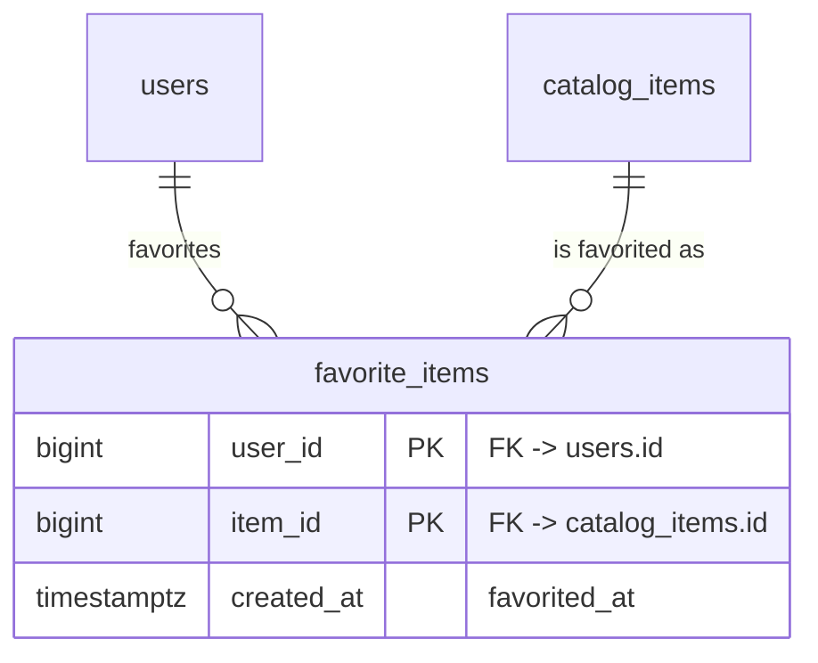

# sandbox-svc — Entity Relationship Diagram

Cumulative ERD across every feature built for this service, maintained
by `/code-preparation` as part of each feature's own PR — see my_need.md
§2.1. Not a substitute for a feature's own `database.md` — this is the
combined picture, that document has the rationale.

`users` and `catalog_items` are existing tables owned by other systems
(auth/session and catalog respectively) — shown only to anchor the
relationship; this service's own features have not yet defined them.

## Tables by feature

| Feature | Tables added/changed |
|---|---|
| [FEAT-001](feature/FEAT-001/database.md) | favorite_items |
