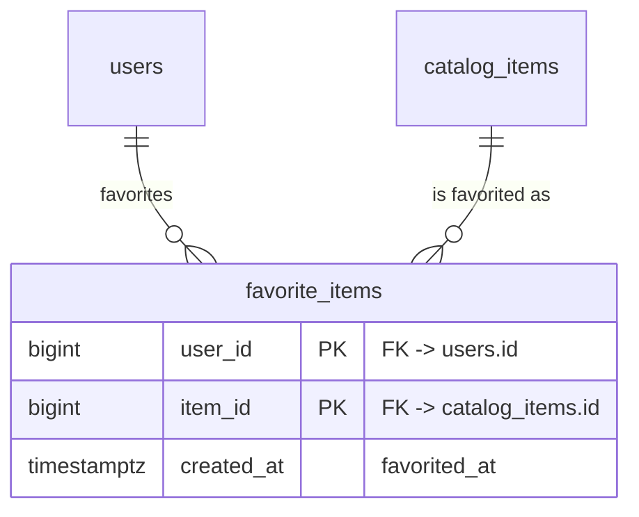

# FEAT-001 — Favorite Items (sandbox-svc) — Database Design

## Revision notes (spec v3)

spec.md v3 added REQ-008 (row-ownership enforcement on
`favorite_items`). **No schema change results.** The composite primary
key `(user_id, item_id)` chosen in Phase 2 already means every row is
inherently addressed by its owner's id — there is no surrogate key a
caller could present without also supplying their own `user_id`, so
there was never a schema-level gap for an ownership column to close.
See `architecture.md`'s REQ-008 note for the one behavioral (not
schema) decision this revision forces.

This is the confirmed output of the schema-designer discipline
(draft ERD -> advisory normalization review -> batched migration plan)
applied to this feature's single, trivial relation. Given the scope (one
join table, no business-workflow state), all three phases are presented
together here for review rather than as separate turns, but each is
still laid out explicitly for confirmation before this file leaves
`draft` status.

## Phase 1 — Draft ERD

One new table: `favorite_items` — a pure (user, item) relation, no
additional attributes beyond lineage.

`users` and `catalog_items` are existing tables owned by the existing
auth/session and catalog systems respectively (per spec.md's
Dependencies) — not created or altered by this feature, shown here only
to anchor the relationship.

## Phase 2 — Normalization review (advisory)

- `favorite_items` is already in 3NF: a single relation with no
  non-key attributes beyond `created_at` (pure lineage, not a
  functional dependency on a subset of the key). No further
  decomposition is applicable.
- **Composite primary key `(user_id, item_id)`, no surrogate key.**
  Per `nexcommon-go-data-standards`' external-UUID-vs-internal-key
  pattern: that pattern exists to give external callers a stable
  reference distinct from an internal join key. Here, the natural key
  *is* the only thing any caller ever addresses this row by (there is
  no "favorite ID" anywhere in the spec or test cases) — a surrogate
  key would be an unused extra column with no consumer. Composite PK
  chosen deliberately, not as an oversight.
- **No soft-delete columns (`is_deleted`/`deleted_at`/`deleted_by`).**
  Un-favoriting (REQ-003) is a literal, permanent retraction of intent —
  "this item is no longer favorited" has no audit/history value once
  it happens, unlike a business entity whose past states matter. A hard
  `DELETE` on un-favorite is correct here; this is not the `status`
  column anti-pattern the guard warns about (there is no `status`
  column at all on this table).
- **No `updated_at`/`updated_by`.** Rows are never mutated in place —
  only inserted (favorite) or deleted (un-favorite) — so there is
  nothing for an update-lineage column to record.
- `created_at` (`favorited_at`) is kept because REQ-002's "My
  Favorites" list is a reasonable place to eventually sort by
  recency — even though sorting is explicitly deferred (spec's
  Priority section), discarding the timestamp now would make that
  later pass need a migration just to recover information this pass
  already has for free. `created_by` is omitted — it would be
  redundant with `user_id`, which is already part of the key.

## Phase 3 — Batched migration plan

Single batch, single table — no sequencing needed.

**Batch 1 (only batch):**
- Create `favorite_items`:
  - `user_id BIGINT NOT NULL REFERENCES users(id)`
  - `item_id BIGINT NOT NULL REFERENCES catalog_items(id)`
  - `created_at TIMESTAMPTZ NOT NULL DEFAULT now()`
  - `PRIMARY KEY (user_id, item_id)`
  - Index: the PK itself (leading column `user_id`) already serves
    both the "list my favorites" query (`WHERE user_id = ?`) and the
    REQ-007 cap-check (`COUNT(*) WHERE user_id = ?`) without a
    separate index.
  - FK column types (`BIGINT`) assumed to match `users.id` /
    `catalog_items.id`'s actual existing types — `/go-dev` confirms
    the exact type against the real schema at migration-authoring time
    and adjusts if either existing table uses a different integer
    width or UUID; this is a compatibility detail for the migration
    author, not a design call this document needs to pre-empt.

**No DDL is written in this document** — per the guard's own rule,
`schema-designer` (and this role) never authors migration files; this
plan is the handoff `/go-dev` implements against.

## Table ownership for ERD.md

`favorite_items` is the only table this feature adds. It will be
recorded in `sandbox-svc/ERD.md`'s "Tables by feature" index against
FEAT-001.
