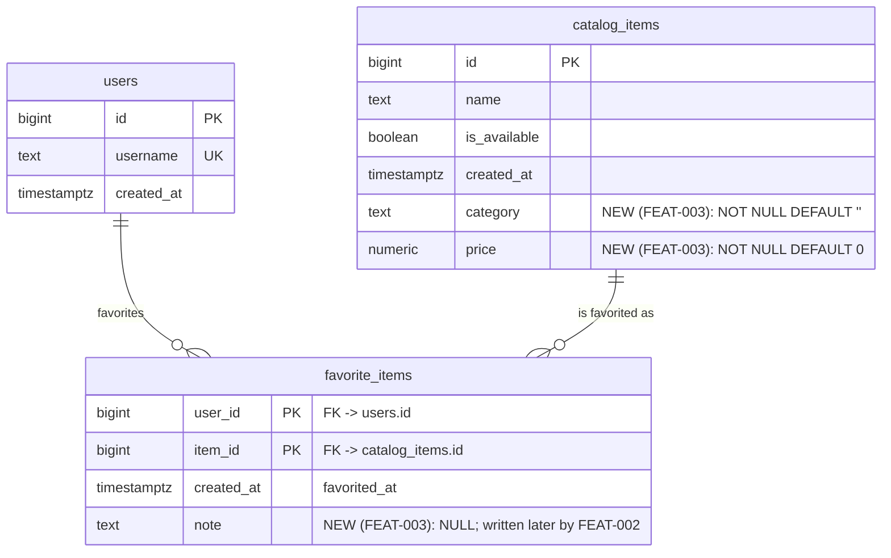

# FEAT-003 — Export my favorites to CSV (sandbox-svc) — Database Design

## Revision notes (spec v1)

First design pass for this feature. Unlike FEAT-001 there is **no new
table**: the export is strictly read-only (spec's Non-Goals) and is
served by one query over `favorite_items` joined to `catalog_items`.
What the current schema cannot supply is three columns — two item
attributes the CSV must write, and the note the CSV must read.

This is the confirmed output of the schema-designer discipline
(draft ERD -> advisory normalization review -> batched migration plan)
applied to those three additive columns, with the user having already
made the feature-level calls this document records:

- `note` belongs to `favorite_items`, not `catalog_items` — a note
  describes *this user's* relationship to the item.
- **`note` is added here, but only as the storage column.** FEAT-002
  (personal notes) owns the write path, its trim/200-character
  validation, and its empty-string-to-NULL rule. FEAT-002 has a spec
  but no architecture/database of its own yet, and is not implemented;
  FEAT-003 therefore adds only the nullable column and reads it. When
  FEAT-002 is designed, its migration must **not** re-add the column —
  it already exists after this batch.
- `category` and `price` are added to the stand-in `catalog_items`,
  because FEAT-003's CSV header requires them and the stand-in does not
  carry them. In production the real catalog service owns these fields.

## Phase 1 — Draft ERD

No new table, no new relation. Three columns are added to tables
FEAT-001 already created; `users` is unchanged and is shown only to
anchor the existing relationship.

Notes on the draft:

- `category` and `price` are **item** attributes, so `catalog_items` is
  the only correct home. Putting them on `favorite_items` would
  duplicate the item's data once per favoriting user, and would
  contradict REQ-015 (values read live from the catalog at export
  time, never a snapshot).
- `note` is a **pairing** attribute, so `favorite_items` is the only
  correct home. It cannot live on `catalog_items` (that would make one
  user's note visible to another) and it must not outlive the favorite
  (FEAT-002 REQ-004). Because it is a column on `favorite_items`, the
  existing `DELETE` (un-favorite) already removes the note with it —
  no cascade or trigger is needed.
- `image_url` is deliberately **not** added. FEAT-001's architecture
  lists it as a display field, but the stand-in schema does not have
  it and FEAT-003's CSV header does not include it. Adding it here
  would be a column no code in this feature reads.
- `favorite_items` keeps FEAT-001's documented deviations (composite
  PK, no surrogate key, no soft-delete columns, no `updated_at`). This
  feature does not revisit them; see FEAT-001's `database.md`.

## Phase 2 — Normalization review (advisory)

1. **1NF — atomic columns.** `category TEXT` and `price NUMERIC` are
   single atomic values, not repeating groups or packed composites.
   `note TEXT` likewise. No change.

2. **2NF — `catalog_items`.** The table has a single-column primary
   key (`id`), so every non-key attribute — including the two new ones
   — depends on the whole key by construction. No partial dependency.

3. **2NF — `favorite_items`.** `note` describes the full
   `(user_id, item_id)` pairing; it does not depend on only one half.
   A note is meaningless without both the user and the item. No
   partial dependency, so the composite PK remains the right key.

4. **3NF — no transitive dependency.** `category` and `price` describe
   `catalog_items.id` directly. They do not depend on `name`,
   `is_available`, or `created_at`, and nothing else determines them.
   `note` depends on `(user_id, item_id)` directly, not through another
   non-key attribute. Both relations are 3NF.

5. **`category` as inline `TEXT` vs. a normalized `categories`
   table.** A separate `categories` table would be right if
   categories ever become first-class entities (managed list, renames,
   their own filter endpoint). Nothing in FEAT-003's spec asks for
   that: the CSV writes the category string as-is and has no filter.
   **Decision: keep `category` inline `TEXT` for this pass.** Revisit
   only when category management is actually in scope, as its own
   migration.

6. **Deliberate non-denormalization: item fields are not copied onto
   `favorite_items`.** Snapshotting `name`/`category`/`price` at
   favorite-time is the reporting-style "price at time of sale"
   pattern. REQ-015 explicitly requires the opposite — the export
   reads the catalog's **current** state — and TC-032 tests exactly
   that. The live join costs one PK lookup per row over at most 500
   rows, so there is no performance argument for a snapshot either.
   Recorded as a deliberate decision, not an oversight.

7. **`note` is nullable (`TEXT NULL`), not `NOT NULL DEFAULT ''`.**
   FEAT-002 REQ-005 says an empty note is equivalent to no note and no
   distinct empty-string note is stored, so NULL is the "no note"
   state; a `NOT NULL DEFAULT ''` would create the second
   representation FEAT-002 explicitly avoids. REQ-008's "no note or
   empty note exports as an empty cell" is therefore satisfied by
   rendering NULL as an empty cell. This does not conflict with
   FEAT-001's conventions — those concern identity, soft-delete and
   update lineage, none of which `note` touches.

8. **`note` length/emptiness constraints are deferred to FEAT-002,
   not added here.** A `CHECK (note IS NULL OR char_length(note) <=
   200)` and a `CHECK (note IS NULL OR btrim(note) <> '')` would
   encode FEAT-002's rules in the database. They are deliberately
   **not** part of this batch: FEAT-003 only adds the column, and the
   write path those constraints guard does not exist yet. FEAT-002 can
   add them with its own migration when it designs its write path.
   Until then the schema permits `''`, so the export must render both
   `NULL` and `''` as an empty cell (REQ-008, TC-018).

9. **`price` type: unconstrained `NUMERIC`, not `NUMERIC(p,s)` and not
   a float.** `NUMERIC` is exact decimal, so `1500`, `19.99` and
   `1234.5678` are stored and returned with no binary rounding. A
   fixed scale would violate REQ-005 directly: `NUMERIC(12,2)` rounds
   `1234.5678` to `1234.57` (TC-012), and any fixed scale adds
   trailing zeros on read (`1500.0000`, `19.9900`) that TC-011/TC-012
   reject. `float`/`double precision` is binary floating point: it
   cannot represent `19.99` exactly, so `::text` output is
   implementation-sensitive and wrong for money. The trade-off of
   unconstrained `NUMERIC` is that it does not constrain scale, so a
   careless writer could store redundant trailing zeros — handled on
   the read side (item 10), not by forcing a scale that loses
   precision.

10. **Reading `price` canonically: `trim_scale(price)::text`.**
    Unconstrained `NUMERIC` preserves the scale it was given, so a row
    inserted as `19.9900` would render as `19.9900` with a plain
    `::text`, which TC-011 rejects. `trim_scale` is value-preserving
    and strips only redundant trailing zeros, and is available on
    PostgreSQL 13+. The repository's compose stack pins
    `postgres:16-alpine`, so it is available here; this is a read-side
    expression in the export DAO, **not** a schema change. If the
    deployment ever targets a pre-13 server, the fallback is
    `price::text` plus canonical numeric literals in every fixture —
    record that choice at that time rather than silently dropping the
    trim.

11. **`category NOT NULL DEFAULT ''` and `price NOT NULL DEFAULT 0`
    are constant defaults, not unknowns.** The stand-in has no
    "unknown category" or "unknown price" concept, and REQ-005 expects
    a raw number in every price cell, so `''`/`0` is the pragmatic
    stand-in for pre-existing rows (there are none in practice — the
    catalog seed is the only writer today). Flag for the **real**
    catalog service, not this stand-in: if "unknown price" must be
    distinguishable from "free", that contract needs a nullable price,
    which is the catalog system's call.

12. **No new index.** The export query filters
    `favorite_items.user_id = ?`; `user_id` is the leading column of
    the existing composite primary key, so it is already indexed. The
    join lookup `catalog_items.id = favorite_items.item_id` uses
    `catalog_items`' primary-key index. The result set is bounded at
    500 rows per user (FEAT-001 REQ-007), so the sort is over a
    trivially small set; a covering index would add write cost for no
    measurable read benefit. **Decision: add no index.**

13. **No audit columns added.** No `created_by` (redundant with
    `user_id` on `favorite_items`; meaningless on `catalog_items`,
    which is a stand-in for another system's table), no `updated_at`
    (favorites are inserted or deleted; `note` writes are FEAT-002's
    concern), no soft-delete columns. This matches the project's
    established convention for these tables.

## Phase 3 — Batched migration plan

**One batch.** There are only two additive changes, they have no
dependency on each other, and the export code needs all three columns
before it runs. Splitting them would create a window where the schema
is half-ready for no gain.

**Proposed file:** `sql_migrations/main/3_export_columns.sql`, following
the existing `N_snake_case.sql` numbering (`1_first_init_db_migration.sql`,
`2_favorite_items.sql`) and the repository's `-- +migrate Up` /
`-- +migrate Down` section convention. If the migration runner requires
one object per file, split into `3_catalog_items_category_price.sql`
then `4_favorite_items_note.sql`; order between them does not matter.

**Batch 1 (only batch):**

| # | Table | Column | Type | Null | Default | Why |
|---|---|---|---|---|---|---|
| 1 | `catalog_items` | `category` | `TEXT` | `NOT NULL` | `''` | Item attribute; `''` is the stand-in's "uncategorized" and avoids NULL handling in the export. |
| 2 | `catalog_items` | `price` | `NUMERIC` (unconstrained precision/scale) | `NOT NULL` | `0` | Exact decimal storage — no rounding, no fixed-scale trailing zeros; `0` keeps REQ-005's raw-number contract total. |
| 3 | `favorite_items` | `note` | `TEXT` | `NULL` | none (`NULL`) | Pairing attribute; FEAT-002 owns the write path and validation; `NULL` is the "no note" state. |

Operational shape:

- Add `category` and `price` in a **single** `ALTER TABLE
  catalog_items ADD COLUMN ..., ADD COLUMN ...` statement — one
  `ACCESS EXCLUSIVE` lock instead of two.
- Add `note` in a separate `ALTER TABLE favorite_items ADD COLUMN ...`
  statement (a different table, so it cannot share the lock anyway).
- **No backfill statements.** Both defaults are constants, so
  PostgreSQL 11+ stores them as a metadata-only default and existing
  rows read the constant. The compose stack is `postgres:16-alpine`,
  so no table rewrite occurs. On a pre-11 server this would rewrite
  the table under the lock — run it in a maintenance window there.
- **No FK changes.** `favorite_items`' existing foreign keys already
  cover the export's join.
- **No CHECK constraints, no indexes, no triggers, no audit columns**
  (Phase 2 items 8 and 12).
- Wrap both statements in one transaction so the schema is never
  half-applied, and set a short `lock_timeout` before each `ALTER` so
  a queued DDL statement fails fast instead of blocking the table
  behind a long-running query.

**Down migration** (reverse order, same transaction): drop
`favorite_items.note`, then `catalog_items.price`, then
`catalog_items.category`. All three are destructive once data exists —
take a backup before running down on a database with real notes or
prices. Run it only after the FEAT-003 code has been reverted; the old
code does not reference the new columns and stays compatible either
way.

**Deploy order:** apply the migration, validate, then deploy the
code. Never deploy the code first — the export query names all three
columns.

**Validation criteria for the batch** (what the implementing session
proves before the batch is considered landed):

- `information_schema.columns` reports `catalog_items.category` as
  `text`, `NOT NULL`, default `''::text`; `catalog_items.price` as
  `numeric`, `NOT NULL`, default `0`; `favorite_items.note` as `text`,
  nullable, no default.
- Pre-existing rows read `category = ''`, `price = 0`,
  `note IS NULL`; no row violates `NOT NULL`.
- Fixture round-trip: rows inserted with `1500`, `19.99` and
  `1234.5678` return exactly those strings from
  `trim_scale(price)::text` — no rounding, no thousands separator, no
  currency symbol.
- `EXPLAIN` on the export query uses the `favorite_items` composite
  primary key for `user_id = ?` and the `catalog_items` primary key
  for the join; no sequential scan over `favorite_items`.
- Index inventory is unchanged — the batch creates no index.
- The down migration, run on a scratch copy, removes all three
  columns and leaves the schema equivalent to the pre-batch state.

## The export query (context for `/go-dev`)

FEAT-003 reads one row per favorite, mirroring FEAT-001's `List` DAO
exactly — both the `LEFT JOIN` and the `COALESCE` fallbacks are kept so
the CSV's values match what `GET /favorites` returns (REQ-019, TC-005):

| CSV column | Source expression | Notes |
|---|---|---|
| `item_id` | `f.item_id` | integer |
| `name` | `COALESCE(c.name, '')` | |
| `category` | `COALESCE(c.category, '')` | new column |
| `price` | `COALESCE(trim_scale(c.price), 0)::text` | text, exact value (REQ-005) |
| `available` | `COALESCE(c.is_available, FALSE)` | rendered `Tersedia` / `Tidak Tersedia` in Go |
| `favorited_at` | `f.created_at` | `timestamptz`; formatted `YYYY-MM-DD` in **Go** with `.UTC()`, never the DB session time zone (REQ-006, TC-003/TC-014) |
| `note` | `f.note` | `NULL` -> empty cell |

Ordering is `f.created_at DESC, f.item_id ASC` — the same order
FEAT-001's `List` uses, so REQ-003's "matching `GET /favorites`" holds
including the tie case (TC-008).

## Table ownership for ERD.md

No table this feature adds. `ERD.md` records the **changed** tables
against FEAT-003 (`catalog_items`, `favorite_items`) with their new
columns, and keeps FEAT-001's row for the table's original creation.

## Documentation drift noted, not corrected here

`sandbox-svc/SERVICE.md` and `sandbox-svc/ERD.md` currently describe
FEAT-003 as "(no schema change)". That was true before this pass and is
now stale. `ERD.md` is updated by this same PR (it is in this role's
write scope). `SERVICE.md` is `/document-preparation`'s file and is
**not** edited here — its FEAT-003 row should be corrected by a later
`/document-preparation` pass to say the export adds three columns and
no table.
