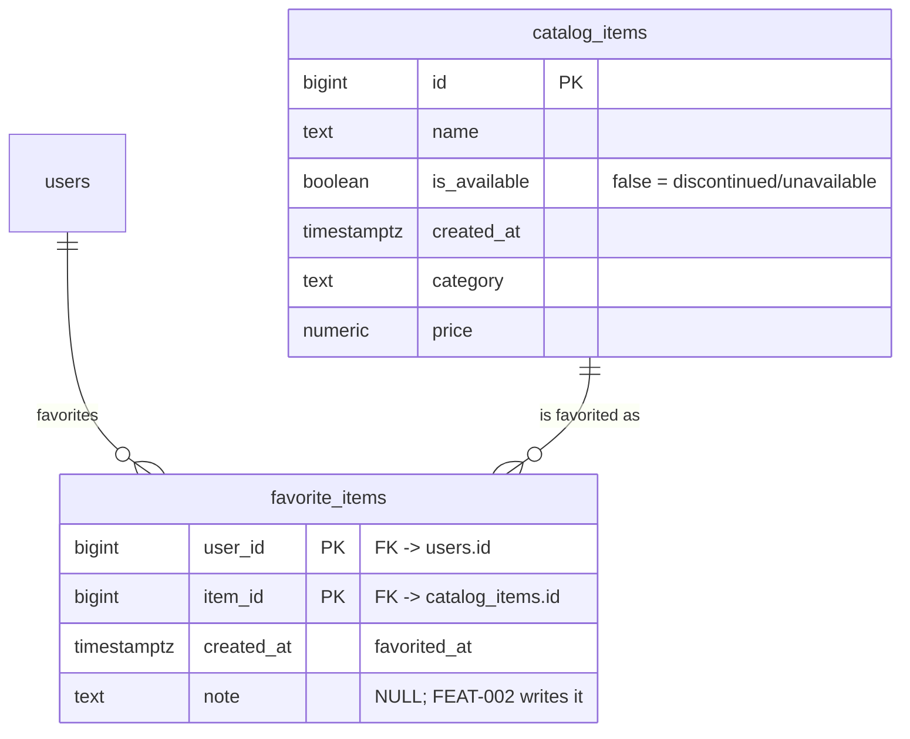

# FEAT-005 — Favorites summary and badge tooltip (sandbox-svc) — Database Design

## Revision notes (spec v1)

First design pass for this feature. **This feature changes no data
shape.** REQ-019 states the dependency explicitly: `total` and
`discontinued` are derived from FEAT-001's existing `favorite_items`
rows joined live to FEAT-003's `catalog_items` columns, and no table,
column, index or constraint is added.

`schema-designer`'s three phases are recorded below rather than skipped,
because the guard requires the position to be explicit, not absent. The
outcome of all three is "not applicable — nothing to change", and **no
migration batch and no DDL are produced**.

## Phase 1 — Draft ERD

**Not applicable: no entity, attribute or relationship is added or
altered.** The relevant part of the existing model is unchanged and is
reproduced here only to anchor the query:



The summary reads `favorite_items` and joins `catalog_items` on its
primary key to read the item's *current* availability. It does not
filter `total` by availability, and it does not store either count.

## Phase 2 — Normalization review (advisory)

Nothing in the schema is being designed, so there is no new relation to
review. The decisions worth recording are deliberate **non-changes**:

1. **No denormalized counter columns** (e.g. `users.favorite_count` or
   `users.discontinued_favorite_count`). A stored counter would need a
   write on every add/remove, a write on every catalog availability
   change, a backfill, and a consistency story for failed transactions —
   real complexity for an aggregate already bounded at 500 rows per user
   (FEAT-001's cap). The spec's Non-Goals forbid new columns and
   caching. **Decision: compute at request time, every time.**

2. **No new index.** The `total` predicate is `favorite_items.user_id =
   $1`; `user_id` is the leading column of the composite primary key
   `(user_id, item_id)`, so the existing PK index already serves it.
   `discontinued` applies a `FILTER` over the same rows, not a separate
   lookup. An extra index would add write cost on every favorite/
   un-favorite for no read benefit. The spec's Non-Goals forbid a new
   index. **Decision: none.**

3. **No soft-delete or workflow-state column.** The summary counts every
   row the user owns. FEAT-001 documented that `favorite_items` uses hard
   delete on un-favorite and has no `is_deleted`/`deleted_at` columns;
   `catalog_items.is_available` is the item's business-availability flag,
   not a row-lifecycle flag. Nothing here revisits either.

4. **No snapshot of availability on `favorite_items`.** REQ-004 requires
   the current state: an item discontinued after it was favorited must
   count as discontinued, and one re-enabled must stop counting. FEAT-003
   already chose the live join for the same reason; this feature follows
   it. **Decision: live join, no snapshot column.**

## Phase 3 — Batched migration plan

**Not applicable: zero batches.** No `sql_migrations/` file is produced
by this feature, no backfill runs, and there is no rollback to plan
because nothing changes. `/go-dev` must not create or edit a migration
for FEAT-005; if it finds itself needing one, the design has been
misread.

## Query and access path (implementation note, not DDL)

```sql
SELECT COUNT(*) AS total,
       COUNT(*) FILTER (WHERE NOT COALESCE(c.is_available, FALSE)) AS discontinued
  FROM favorite_items f
  LEFT JOIN catalog_items c ON c.id = f.item_id
 WHERE f.user_id = $1
```

- Returns one row for every user, including a user with no favorites
  (`total = 0`, `discontinued = 0`) — the normal zero-favorites case
  (REQ-012), not a missing result.
- `LEFT JOIN` plus `COALESCE(c.is_available, FALSE)` mirrors
  `dao.List`: a favorite whose catalog row is missing stays in `total`
  and is treated as unavailable in `discontinued`. It is never dropped
  from `total`, which is what REQ-003 forbids.
- `discontinued` is a subset of `total` by construction: both are
  counts over the same `favorite_items` row set for the same user, and
  the `FILTER` only narrows the second.
- Expected plan on the current schema: an index scan on the
  `favorite_items` primary key with `user_id` as the leading column, then
  a primary-key lookup into `catalog_items` per row. The row set is
  bounded by the 500-per-user cap.
- No transaction, no lock, no write. The read is safe to run
  concurrently with add/remove; a concurrent mutation can only change
  which correct value the caller sees, never the consistency of the row
  set.

## ERD.md

`sandbox-svc/ERD.md` is not modified by this feature: it indexes tables
added or changed per feature, and FEAT-005 adds or changes none. No row
is added to its `## Tables by feature` table.
